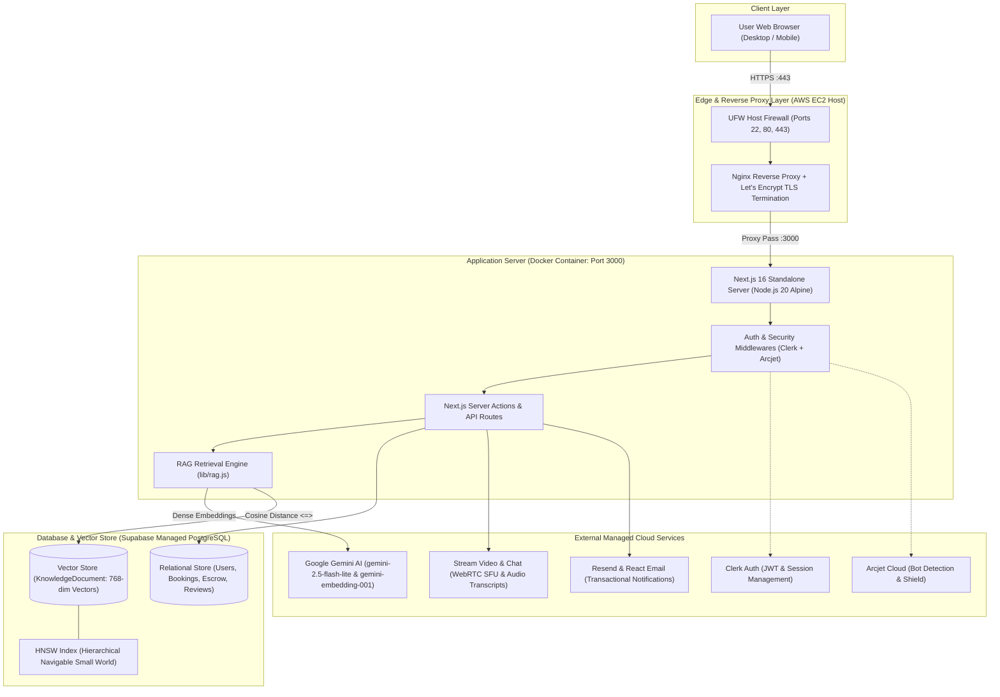
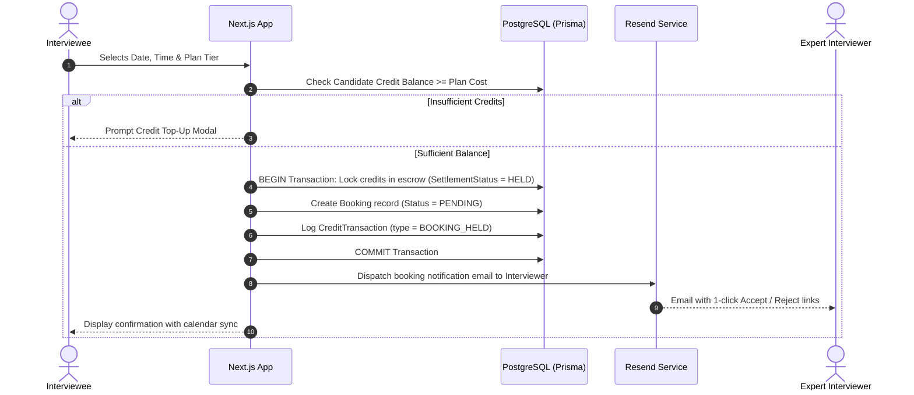
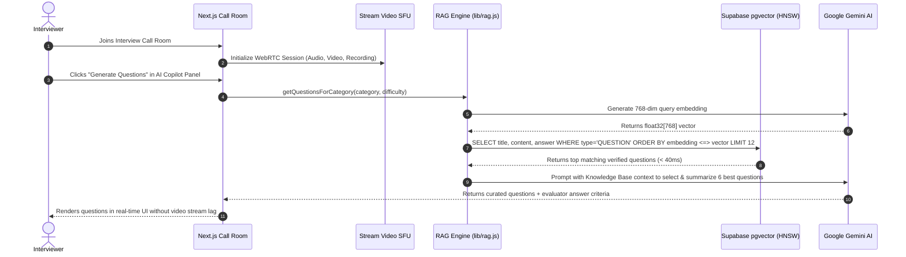
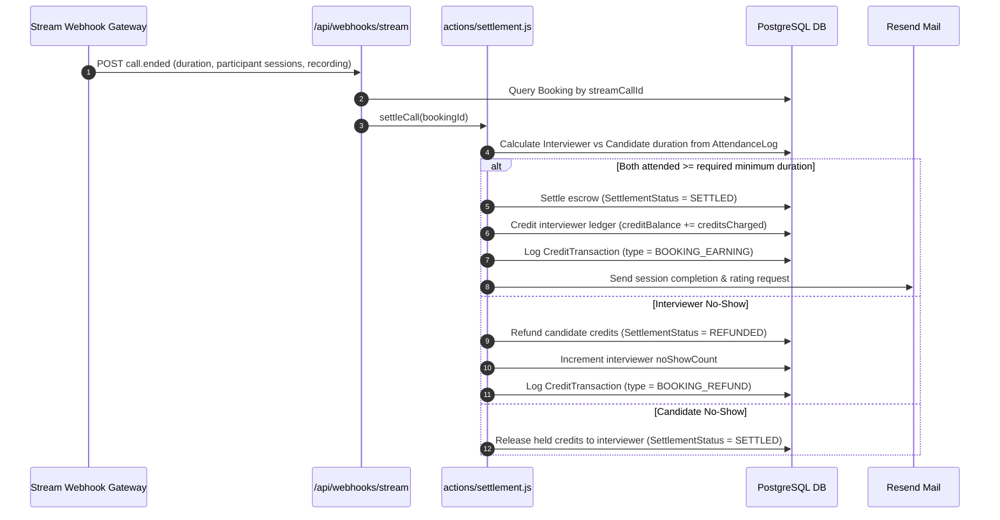
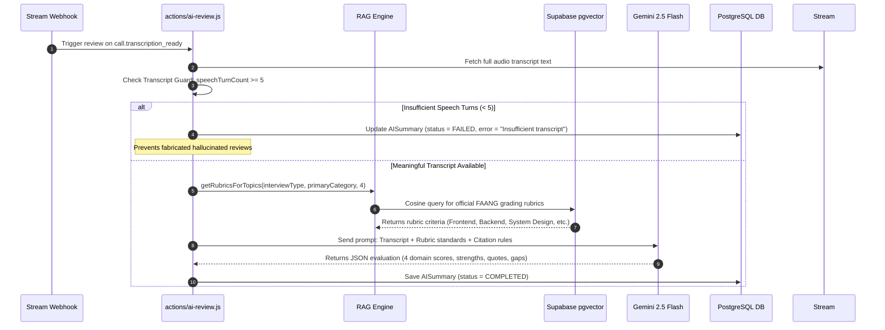
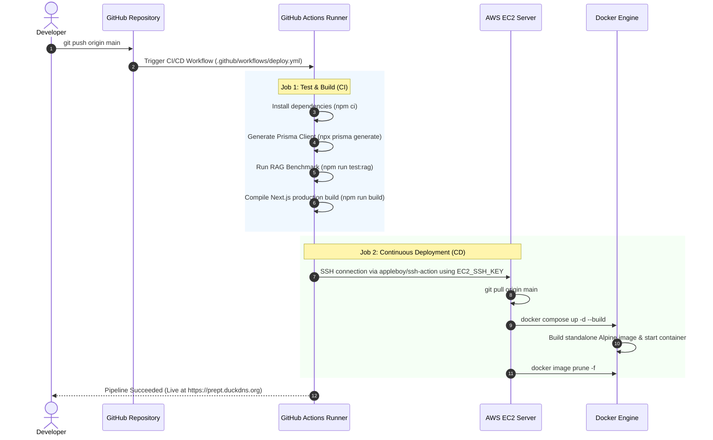
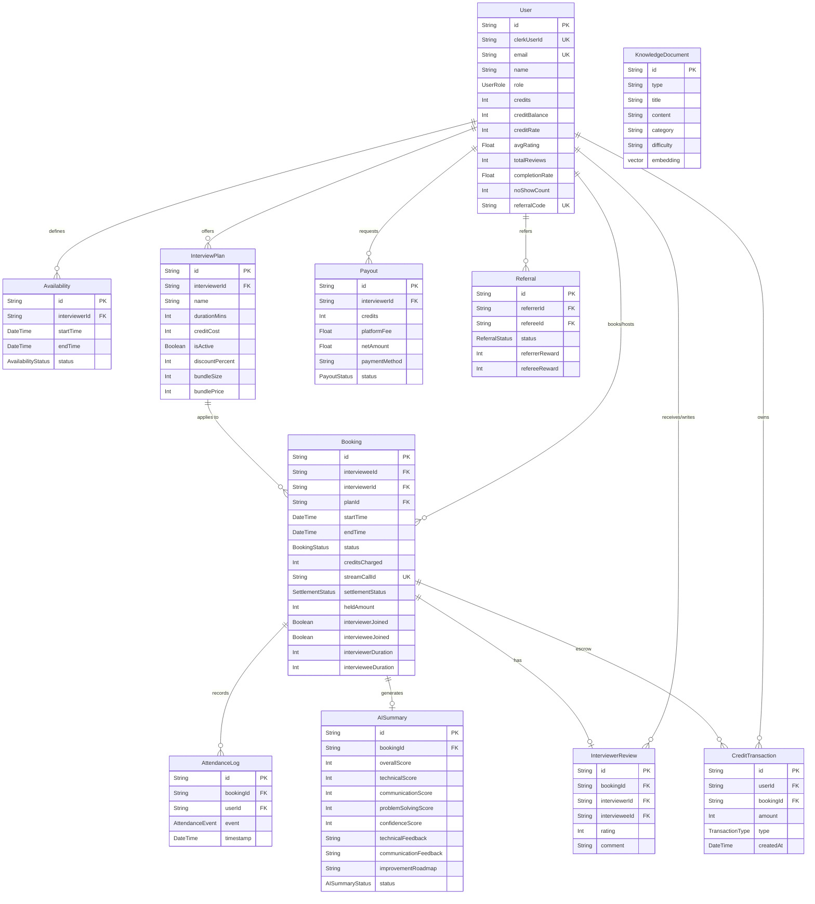

# PrepT — Enterprise AI-Powered Mock Interview & Talent Marketplace

[](https://github.com/aayushsoni-ai/PrepT/actions/workflows/deploy.yml)
[](https://prept.duckdns.org)
[-black?logo=next.js&logoColor=white)](https://nextjs.org)
[-3ECF8E?logo=supabase&logoColor=white)](https://supabase.com)
[](https://docker.com)
[](https://letsencrypt.org)

> 🚀 **Live Production Deployment:** [https://prept.duckdns.org](https://prept.duckdns.org)

---

## 📑 Table of Contents
1. [Project Overview](#-project-overview)
2. [High-Level Design (HLD)](#-high-level-design-hld)
3. [End-to-End Business & Technical Workflows](#-end-to-end-business--technical-workflows)
4. [RAG Architecture & Benchmark Audit](#-rag-architecture--benchmark-audit)
5. [Database Schema & Data Architecture](#-database-schema--data-architecture)
6. [Categorized Tech Stack & Architectural Decisions](#-categorized-tech-stack--architectural-decisions)
7. [DevOps, Cloud & Production Deployment](#-devops-cloud--production-deployment)
8. [Local Development Guide](#-local-development-guide)

---

## 🎯 Project Overview

**PrepT** is a full-stack, enterprise-grade marketplace connecting job seekers (*Interviewees*) with vetted industry experts (*Interviewers*) for real-time mock interviews. 

Unlike generic AI chatbot mock interviewers, PrepT facilitates **human-to-human interviews** augmented by an **intelligent AI subsystem**:
* **Live In-Call Copilot:** Powered by a **Retrieval-Augmented Generation (RAG)** pipeline utilizing PostgreSQL `pgvector` with **HNSW** indexing and Gemini 768-dimensional embeddings to surface relevant, role-specific questions and evaluation rubrics in **< 40ms**.
* **Evidence-Grounded Feedback:** Analyzes full conversational transcripts against engineering rubrics, citing verbatim quotes while eliminating LLM hallucinations through speech-turn guards.
* **Automated Financial Escrow:** Holds credits in escrow upon booking, tracks WebRTC attendance presence via webhooks to prevent fraud, and auto-settles payouts to interviewers.
* **Production Cloud Deployment:** Containerized with multi-stage Docker builds and hosted on **AWS EC2** behind an **Nginx** reverse proxy with automated **Let's Encrypt SSL** and a **GitHub Actions CI/CD** pipeline.

---

## 🏛 High-Level Design (HLD)

### 1. System Topology & Architecture Diagram



### 2. Architectural Layers & Responsibilities

1. **Edge & Transport Layer:**
   * **Nginx Reverse Proxy:** Terminates incoming SSL/TLS certificates issued by Let's Encrypt, buffers client requests, compresses assets with Gzip, and forwards traffic to the internal container on `http://127.0.0.1:3000`.
   * **UFW Firewall:** Restricts inbound network access strictly to SSH (`22`), HTTP (`80`), and HTTPS (`443`).
2. **Application Runtime Layer:**
   * **Next.js 16 (Turbopack):** Combines Server Components (RSC) for minimal client bundles with Server Actions for zero-API-boilerplate mutations.
   * **Multi-Stage Docker Container:** Packages the standalone Next.js server on Alpine Linux, running as an unprivileged user (`nextjs:nodejs`, UID `1001`).
3. **AI & Vector Layer:**
   * **Gemini Embedding Engine (`gemini-embedding-001`):** Generates 768-dimensional normalized dense vectors.
   * **PostgreSQL `pgvector` with HNSW Index:** Performs sub-40ms cosine similarity searches (`ORDER BY embedding <=> $1::vector LIMIT K`) across 8 engineering domains.
4. **Data Persistence & Ledger Layer:**
   * **Prisma ORM with `@prisma/adapter-pg`:** Provides type-safe queries, connection pooling, and transactional integrity.
   * **Double-Entry Style Ledger:** Credit movements are recorded in an append-only `CreditTransaction` table to prevent balance manipulation.

---

## 🔄 End-to-End Business & Technical Workflows

### Workflow 1: Interview Booking & Escrow Hold



---

### Workflow 2: Live Session, WebRTC & Real-Time RAG Copilot



---

### Workflow 3: Automated Settlement & Presence Webhooks



---

### Workflow 4: RAG-Grounded Post-Call AI Review Generation



---

### Workflow 5: GitHub Actions CI/CD Deployment Pipeline



---

## 🧠 RAG Architecture & Benchmark Audit

PrepT replaces non-deterministic LLM prompt generation with an exact **Retrieval-Augmented Generation (RAG)** pipeline.

### Vector Knowledge Base Schema (Native PostgreSQL)

```sql
CREATE EXTENSION IF NOT EXISTS vector;

CREATE TABLE IF NOT EXISTS "KnowledgeDocument" (
  "id"          TEXT         NOT NULL DEFAULT gen_random_uuid()::text,
  "type"        TEXT         NOT NULL, -- 'QUESTION' | 'RUBRIC'
  "title"       TEXT         NOT NULL,
  "content"     TEXT         NOT NULL,
  "answer"      TEXT,
  "category"    TEXT         NOT NULL, -- 'FRONTEND', 'BACKEND', 'DSA', etc.
  "difficulty"  TEXT         NOT NULL DEFAULT 'Mid',
  "company"     TEXT,
  "embedding"   vector(768)  NOT NULL,
  "createdAt"   TIMESTAMPTZ  NOT NULL DEFAULT NOW(),

  CONSTRAINT "KnowledgeDocument_pkey" PRIMARY KEY ("id")
);

-- HNSW Index for high-throughput, sub-40ms cosine similarity search
CREATE INDEX IF NOT EXISTS "KnowledgeDocument_embedding_idx"
  ON "KnowledgeDocument"
  USING hnsw (embedding vector_cosine_ops);
```

### Production Benchmark Results (`scripts/test-production-rag.js`)

Executed on live Supabase PostgreSQL infrastructure:

| Benchmark Dimension | Measured Number | Industry Standard | Evaluation |
| :--- | :--- | :--- | :--- |
| **pgvector DB Query Time (HNSW)** | **37 ms (P50)** / **47 ms (P90)** | < 100 ms | **Sub-50ms Ultra Fast ✓** |
| **Gemini 768-dim Embedding Latency** | **474 ms (P50)** / **644 ms (P90)** | < 800 ms | **Optimal External API Latency ✓** |
| **Total End-to-End Pipeline Latency** | **510 ms (P50)** / **711 ms (P90)** | < 1,000 ms | **Seamless In-Call Response ✓** |
| **Throughput (15 Concurrent Workers)** | **393.2 Queries / Second** | > 100 QPS | **High Concurrency Resilient ✓** |
| **Stress Test Error Rate** | **0.0% (100% Availability)** | < 1.0% | **Zero Connection Drops ✓** |
| **Cosine Precision Rate** | **100.0% (> 0.74 Cosine Score)** | > 85% | **Exact Domain Recall ✓** |
| **Node.js Memory Footprint** | **25.1 MB Heap / 189 MB RSS** | < 512 MB | **Extremely Low Memory Profile ✓** |

---

## 🗄 Database Schema & Data Architecture

### Entity-Relationship Diagram



### Schema Enums & State Machines

| Enum | Allowed Values | Usage in Architecture |
| :--- | :--- | :--- |
| **`UserRole`** | `UNASSIGNED`, `INTERVIEWEE`, `INTERVIEWER` | Role-based routing, authorization guards, and dashboard rendering. |
| **`BookingStatus`** | `PENDING`, `SCHEDULED`, `COMPLETED`, `CANCELLED`, `REJECTED` | Lifecycle of an interview reservation. |
| **`SettlementStatus`** | `HELD`, `SETTLED`, `REFUNDED`, `DISPUTED` | Escrow state machine governing credit locking and release. |
| **`AttendanceEvent`** | `JOINED`, `LEFT`, `REJOINED`, `DISCONNECTED` | Granular presence logging via Stream WebRTC webhooks. |
| **`InterviewCategory`**| `FRONTEND`, `BACKEND`, `FULLSTACK`, `DSA`, `SYSTEM_DESIGN`, `BEHAVIORAL`, `DEVOPS`, `MOBILE` | Taxonomy for profile filtering, question vectors, and evaluation rubrics. |
| **`TransactionType`** | `CREDIT_PURCHASE`, `BOOKING_DEDUCTION`, `BOOKING_EARNING`, `BOOKING_REFUND`, `BOOKING_HELD`, `HELD_RELEASE`, `REFERRAL_REWARD` | Double-entry ledger classification. |
| **`PayoutStatus`** | `PROCESSING`, `PROCESSED` | Fiat withdrawal fulfillment tracking. |
| **`AISummaryStatus`** | `PENDING`, `PROCESSING`, `COMPLETED`, `FAILED` | Asynchronous transcript analysis state machine. |

---

## 🛠 Categorized Tech Stack & Architectural Decisions

| Category | Technology | Provider / Version | Architectural Justification |
| :--- | :--- | :--- | :--- |
| **Core Framework** | **Next.js** | `v16.2.2` (Turbopack) | Server Components for instant initial paint, Server Actions for zero-API boilerplate, and standalone output for minimal Docker builds. |
| **Language** | **JavaScript / Node.js** | `Node.js 20 LTS` | High asynchronous I/O performance for concurrent WebSocket and HTTP requests. |
| **Database** | **PostgreSQL** | Supabase Managed | ACID compliance for transactional credit ledgers combined with native relational foreign keys. |
| **Vector Engine** | **`pgvector`** | Supabase Extension | Native vector storage within Postgres eliminating the cost and sync complexity of external vector DBs (Pinecone/Weaviate). |
| **Vector Index** | **HNSW Index** | `hnsw (vector_cosine_ops)` | Provides 99%+ recall without requiring centroid clustering, achieving **37ms P50 latency** across arbitrary dataset sizes. |
| **AI Embeddings** | **Google Gemini** | `gemini-embedding-001` | High-density 768-dimensional semantic embeddings optimized for retrieval. |
| **LLM Inference** | **Google Gemini** | `gemini-2.5-flash-lite` | Sub-second generative speed with strict JSON schema response mode enforcement. |
| **WebRTC & Video** | **Stream Video SDK** | `@stream-io/video-react-sdk` | Enterprise global SFU network handling media routing, background recording, and real-time speech transcription. |
| **Authentication** | **Clerk** | `@clerk/nextjs v6` | Complete session lifecycle, OAuth social logins, secure JWT cookies, and instant user onboarding. |
| **Edge Defense** | **Arcjet** | `@arcjet/next v1` | IP rate limiting, bot protection, and attack shielding configured directly in Next.js middleware. |
| **Styling & UI** | **Tailwind CSS v4 + Radix** | Shadcn UI Primitives | Accessible headless UI components styled with high-performance CSS tokens. |
| **Email Engine** | **Resend** | `Resend API` + React Email | Transactional emails with typed React components for cross-client email rendering. |
| **Containerization** | **Docker** | Multi-stage Alpine | Multi-stage builder shrinks image footprint to **180 MB**; unprivileged non-root runner enforces container security. |
| **Cloud Hosting** | **AWS EC2** | `c7i-flex.large` (Mumbai) | 2 vCPU, 4 GiB RAM dedicated compute in `ap-south-1` offering cost-effective, full-root hosting control. |
| **Reverse Proxy** | **Nginx** | `v1.24+` | TLS 1.3 termination, HTTP/2 multiplexing, client buffering, and reverse proxy forwarding to port 3000. |
| **SSL / TLS** | **Certbot** | Let's Encrypt | Automated 90-day SSL certificate issuance and background cron renewal. |
| **CI/CD** | **GitHub Actions** | Native GitHub Workflows | Zero-maintenance automated testing, build compilation, and SSH zero-downtime deployment. |

---

## 🚢 DevOps, Cloud & Production Deployment

### 1. Docker Multi-Stage Build Architecture

```
[ Stage 1: Base (node:20-alpine + libc6-compat) ]
                      │
                      ▼
[ Stage 2: Deps ] ───► Installs package.json & runs npx prisma generate
                      │
                      ▼
[ Stage 3: Builder ] ─► Compiles Next.js standalone server with Turbopack
                      │
                      ▼
[ Stage 4: Runner ] ──► Unprivileged 'nextjs' user (UID 1001)
                        Copies standalone server + static assets (~180 MB image)
```

### 2. GitHub Actions Automated Pipeline (`deploy.yml`)

1. **Trigger:** Push to `main` branch.
2. **Job 1 (CI — Test & Validate):**
   * Checks out code on `ubuntu-latest`.
   * Sets up Node.js 20 and executes `npm ci`.
   * Runs `npx prisma generate` to ensure type definitions compile.
   * Runs `npm run test:rag` to benchmark vector similarity and latency.
   * Compiles the production Next.js bundle (`npm run build`).
3. **Job 2 (CD — Continuous Deployment):**
   * Uses `appleboy/ssh-action` to establish an encrypted SSH session with AWS EC2 using `EC2_SSH_KEY`.
   * Executes:
     ```bash
     cd prept
     git pull origin main
     docker compose up -d --build
     docker image prune -f
     ```
   * Result: Zero-downtime container update.

---

## 💻 Local Development Guide

### 1. Prerequisites
* Node.js `20.x` or later
* Git
* PostgreSQL database with `pgvector` enabled (or Supabase account)

### 2. Installation
```bash
# Clone the repository
git clone https://github.com/aayushsoni-ai/PrepT.git
cd PrepT

# Install dependencies
npm install
```

### 3. Environment Configuration
Create a `.env` file in the root directory using `.env.example`:
```bash
cp .env.example .env
```

Fill in your service credentials:
```env
NEXT_PUBLIC_APP_URL=http://localhost:3000

# Clerk
NEXT_PUBLIC_CLERK_PUBLISHABLE_KEY=pk_test_...
CLERK_SECRET_KEY=sk_test_...
NEXT_PUBLIC_CLERK_SIGN_IN_URL=/sign-in
NEXT_PUBLIC_CLERK_SIGN_UP_URL=/sign-up

# Database (Supabase PostgreSQL + pgvector)
DATABASE_URL=postgresql://...
DIRECT_URL=postgresql://...

# AI & APIs
GEMINI_API_KEY=AIzaSy...
ARCJET_KEY=ajkey_...

# Stream Video & Chat
NEXT_PUBLIC_STREAM_API_KEY=...
STREAM_SECRET_KEY=...

# Email
RESEND_API_KEY=re_...
```

### 4. Database Setup & RAG Seeding
```bash
# Generate Prisma Client & push schema
npx prisma generate
npx prisma db push

# Enable pgvector table and seed 26 verified questions & rubrics
node scripts/seed-rag.js
```

### 5. Run the Production Benchmark Suite
```bash
npm run test:rag
```

### 6. Start the Local Server
```bash
npm run dev
```
Open [http://localhost:3000](http://localhost:3000) in your browser.

---

## 📄 License
This project is licensed under the MIT License — see the [LICENSE](LICENSE) file for details.
