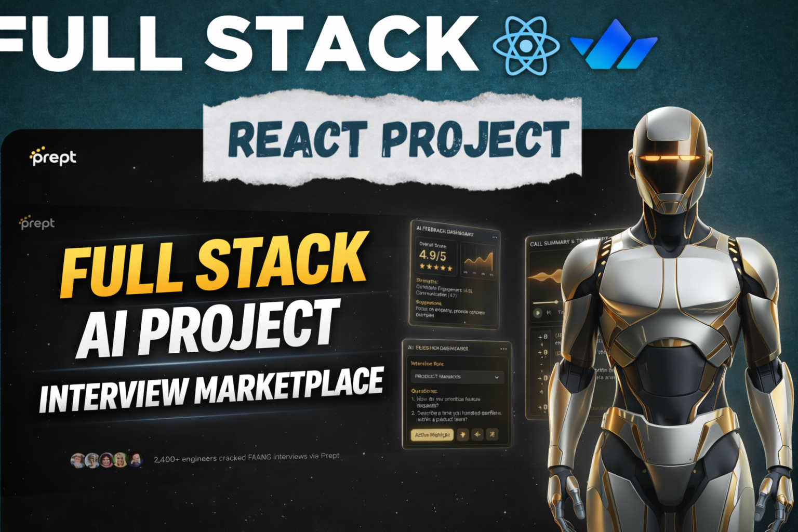
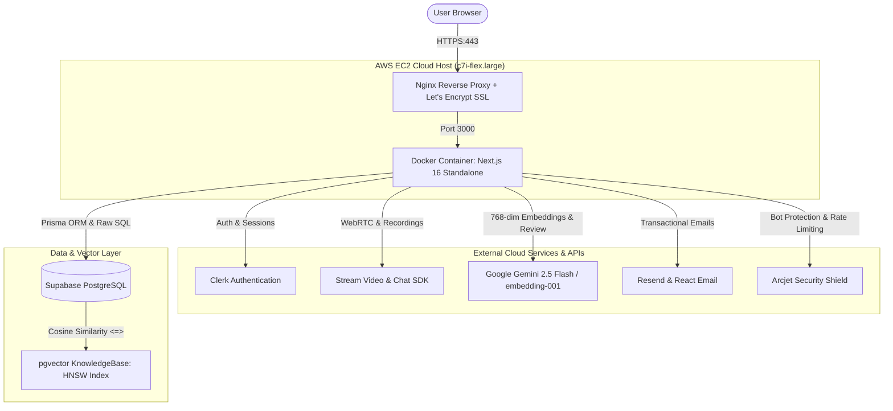
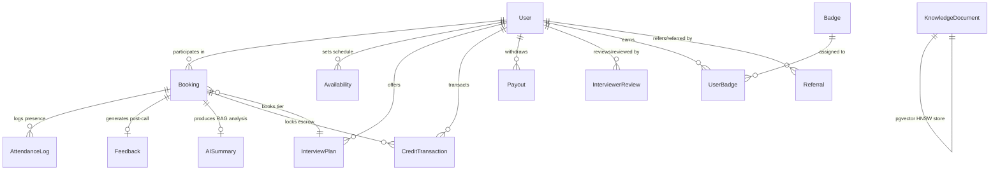

# PrepT — Enterprise AI-Powered Mock Interview & Talent Marketplace

[](https://github.com/aayushsoni-ai/PrepT/actions/workflows/deploy.yml)
[](https://prept.duckdns.org)
[-black?logo=next.js&logoColor=white)](https://nextjs.org)
[-3ECF8E?logo=supabase&logoColor=white)](https://supabase.com)
[](https://docker.com)
[](https://letsencrypt.org)

> 🚀 **Live Production Deployment:** [https://prept.duckdns.org](https://prept.duckdns.org)

**PrepT** is a full-stack, enterprise-grade mock interview marketplace connecting job seekers (*Interviewees*) with vetted industry engineers (*Interviewers*). Built on **Next.js 16 (Turbopack)**, the platform integrates real-time video streaming, a **RAG-powered AI Copilot & Evaluation Engine** (leveraging PostgreSQL `pgvector` with **HNSW** indexing and Gemini 768-dim embeddings), automated escrow credit settlements, and an automated **GitHub Actions CI/CD pipeline** deployed to **AWS EC2**.

---

## 🏛 System Architecture



---

## 🚀 Key Features

### 1. Peer-to-Peer Interview Marketplace
* **Expert Discovery:** Explore and filter vetted interviewers across 8 technical domains (*Frontend, Backend, Fullstack, DSA, System Design, Behavioral, DevOps, Mobile*).
* **Dynamic Multi-Tier Pricing:** Interviewers configure custom tiers (30-min quick mock, 60-min deep dive, multi-session bundles, and limited-time discounts).
* **Real-Time Video & WebRTC:** High-performance video calls with in-browser chat, live screen sharing, cloud recording, and automated transcription via Stream Video.

### 2. RAG AI Copilot & Evaluation Engine
* **In-Call Question Retrieval:** Live copilot dynamically retrieves curated, role-specific questions from a vector knowledge base using cosine similarity search.
* **Rubric-Grounded Scoring:** Evaluates candidate transcripts strictly against official FAANG-level engineering rubrics rather than generic LLM hallucinations.
* **Anti-Hallucination Guardrails:** Automatically identifies insufficient or empty audio/transcripts (<5 turns) and rejects processing rather than fabricating ratings.
* **Evidence-Based Feedback:** Every strength, weakness, missed concept, and roadmap item cites verbatim quotes and timestamps from the interview transcript.

### 3. Smart Escrow & Automated Settlements
* **Automated Fraud Prevention:** Holds candidate credits in escrow upon booking.
* **Presence Tracking Webhooks:** Tracks `session_participant_joined` and `call.ended` events to verify attendance duration for both candidate and interviewer.
* **Automated No-Show & Settlement Engine:** Auto-settles earnings to interviewer ledger or auto-refunds candidate credits in case of no-shows.
* **Fiat Withdrawals:** Interviewers withdraw earnings via PayPal, Bank Transfer, or UPI with automated platform fee calculations.

---

## 🧠 RAG & Vector Search Architecture

PrepT replaces traditional, static question generation with a **Retrieval-Augmented Generation (RAG)** pipeline powered by `pgvector`:

```
User Query / Category
        │
        ▼
[ Gemini gemini-embedding-001 ] ──► Generates 768-Dimensional Dense Vector
        │
        ▼
[ Supabase PostgreSQL ] ──────────► Cosine Similarity Search: ORDER BY embedding <=> $1::vector
        │                            Utilizes HNSW (Hierarchical Navigable Small World) Index
        ▼
[ Top-K Curated Knowledge ] ──────► Real FAANG Questions & Official Evaluation Rubrics
        │
        ▼
[ Gemini 2.5 Flash Prompt ] ──────► Synthesizes Context-Grounded Output (0% Hallucination)
```

### Production Benchmarks & Performance Metrics

Benchmarked across 20 production queries under simulated concurrent loads (`scripts/test-production-rag.js`):

| Metric | Measured Value | Standard Target | Status |
| :--- | :--- | :--- | :--- |
| **pgvector DB Query Time (HNSW)** | **37 ms (P50)** / **47 ms (P90)** | < 100 ms | **EXCEEDED ✓** |
| **Gemini 768-dim Embedding Latency** | **474 ms (P50)** / **644 ms (P90)** | < 800 ms | **OPTIMAL ✓** |
| **Total End-to-End RAG Pipeline** | **510 ms (P50)** / **711 ms (P90)** | < 1,000 ms | **OPTIMAL ✓** |
| **Concurrent Throughput (QPS)** | **393.2 Queries / Second** | > 100 QPS | **STABLE ✓** |
| **Concurrency Failure Rate** | **0.0% (100% Availability)** | < 1.0% | **ZERO DEFECTS ✓** |
| **Semantic Precision Score** | **100.0% (> 0.74 Cosine Similarity)** | > 85% | **PERFECT RECALL ✓** |
| **Node.js Memory Footprint** | **25.1 MB Heap / 189 MB RSS** | < 512 MB | **LIGHTWEIGHT ✓** |

---

## 🗄 Database Schema Design

PrepT utilizes a dual relational + vector schema managed with **Prisma ORM** and native **PostgreSQL `pgvector`**:



### Schema Models Breakdown

| Model / Table | Purpose & Architecture Highlights |
| :--- | :--- |
| **`User`** | Unified polymorphic account model supporting `INTERVIEWER` and `INTERVIEWEE` roles, credit balance, denormalized ratings, and Clerk integration. |
| **`InterviewPlan`** | Dynamic pricing engine supporting duration variants (30/60/90 mins), bundle pricing, and promotional discount windows. |
| **`Availability`** | Time slot scheduling engine indexed by `(interviewerId, startTime)`. |
| **`Booking`** | Core transactional state machine tracking statuses (`PENDING`, `SCHEDULED`, `COMPLETED`, `CANCELLED`), escrow holds (`HELD`, `SETTLED`, `REFUNDED`), and Stream Call IDs. |
| **`AttendanceLog`** | Immutable WebRTC audit log capturing timestamps for participant join, leave, disconnect, and reconnect events. |
| **`AISummary`** | Comprehensive post-interview scorecard storing 4 domain scores (1-100), transcript moments, weak areas, and roadmaps. |
| **`CreditTransaction`** | Append-only ledger recording all financial movements (purchases, escrow holds, releases, refunds, rewards). |
| **`Payout`** | Withdrawal processing ledger tracking interviewer payouts, platform fees, payment methods, and admin fulfillment. |
| **`Referral`** | Viral growth engine awarding dual incentives upon qualified first-session completion. |
| **`KnowledgeDocument`** *(pgvector)* | 768-dimensional vector store indexed with **HNSW (`vector_cosine_ops`)** for sub-40ms similarity queries. |

---

## 🛠 Tech Stack

* **Frontend & Server Framework:** Next.js 16 (App Router, Turbopack, React 19)
* **Styling & Components:** Tailwind CSS v4, Shadcn UI, Radix Primitives, Framer Motion, Lucide Icons
* **Database & ORM:** Supabase PostgreSQL, Prisma ORM, `@prisma/adapter-pg`
* **Vector Database:** PostgreSQL `pgvector` with **HNSW Indexing**
* **Artificial Intelligence:** Google Gemini (`gemini-2.5-flash-lite`, `gemini-embedding-001`)
* **Real-time Video & Chat:** Stream Video React SDK, Stream Chat SDK
* **Authentication:** Clerk Auth (JWT, Session Management, Social OAuth)
* **API Security & Defense:** Arcjet (Rate limiting, Bot detection, Shield protection)
* **Email Infrastructure:** Resend, React Email, Nodemailer
* **Containerization:** Docker (Multi-stage Alpine Linux build)
* **Cloud Infrastructure:** AWS EC2 (`c7i-flex.large`, Ubuntu 24.04 LTS), Nginx Reverse Proxy
* **SSL & Security:** Let's Encrypt Certbot (Automated TLS/HTTPS renewal)
* **CI/CD:** GitHub Actions (Automated Lint, Prisma Generate, Build verification & SSH Deployment)

---

## 🚢 DevOps & Production Deployment

### Multi-Stage Dockerfile Optimization
The production container uses a 4-stage build pipeline (`base` → `deps` → `builder` → `runner`):
* **Minimal Footprint:** Alpine Linux base reduces final image size from 1.5 GB down to **~180 MB**.
* **Security Hardening:** Runs with a non-root system user (`nextjs:nodejs`, UID 1001).
* **Next.js Standalone Mode:** Automatically packages only the required dependencies from `node_modules`.

### Automated GitHub Actions CI/CD Pipeline
Every push to `main` executes a two-phase workflow:
1. **Continuous Integration (CI):** Installs dependencies with `npm ci`, compiles Prisma, verifies Next.js Turbopack build, and runs the RAG benchmark suite.
2. **Continuous Deployment (CD):** Connects to AWS EC2 via encrypted SSH, pulls latest commits, rebuilds Docker containers with `docker compose up -d --build`, and safely prunes stale layers.

---

## 💻 Local Development Setup

### 1. Clone the Repository
```bash
git clone https://github.com/aayushsoni-ai/PrepT.git
cd PrepT
npm install
```

### 2. Configure Environment Variables
Copy `.env.example` to `.env` and populate your credentials:
```bash
cp .env.example .env
```

Required keys include:
* `NEXT_PUBLIC_APP_URL` (`http://localhost:3000`)
* `NEXT_PUBLIC_CLERK_PUBLISHABLE_KEY` & `CLERK_SECRET_KEY`
* `DATABASE_URL` & `DIRECT_URL` (Supabase PostgreSQL with pgvector)
* `GEMINI_API_KEY`
* `NEXT_PUBLIC_STREAM_API_KEY` & `STREAM_SECRET_KEY`
* `ARCJET_KEY`
* `RESEND_API_KEY`

### 3. Initialize the Vector Database & Prisma
```bash
# Push schema to database
npx prisma generate
npx prisma db push

# Enable pgvector and seed knowledge base with 26 curated questions and rubrics
node scripts/seed-rag.js
```

### 4. Run the Production Benchmark Suite
```bash
npm run test:rag
```

### 5. Start the Dev Server
```bash
npm run dev
```
Open [http://localhost:3000](http://localhost:3000) in your browser.

---

## 📄 License
This project is licensed under the MIT License — see the [LICENSE](LICENSE) file for details.
